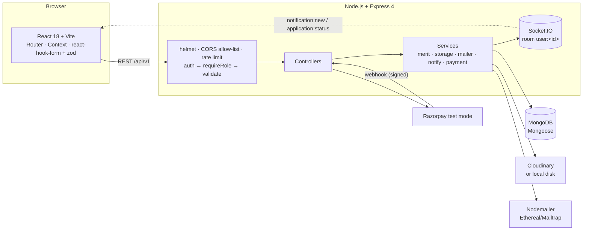
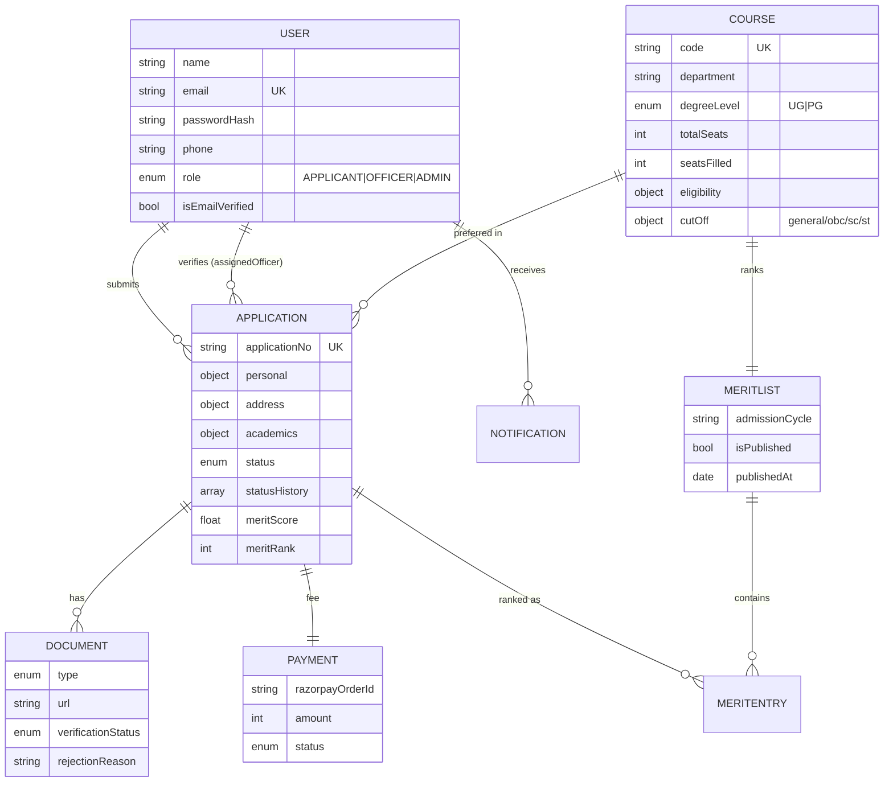
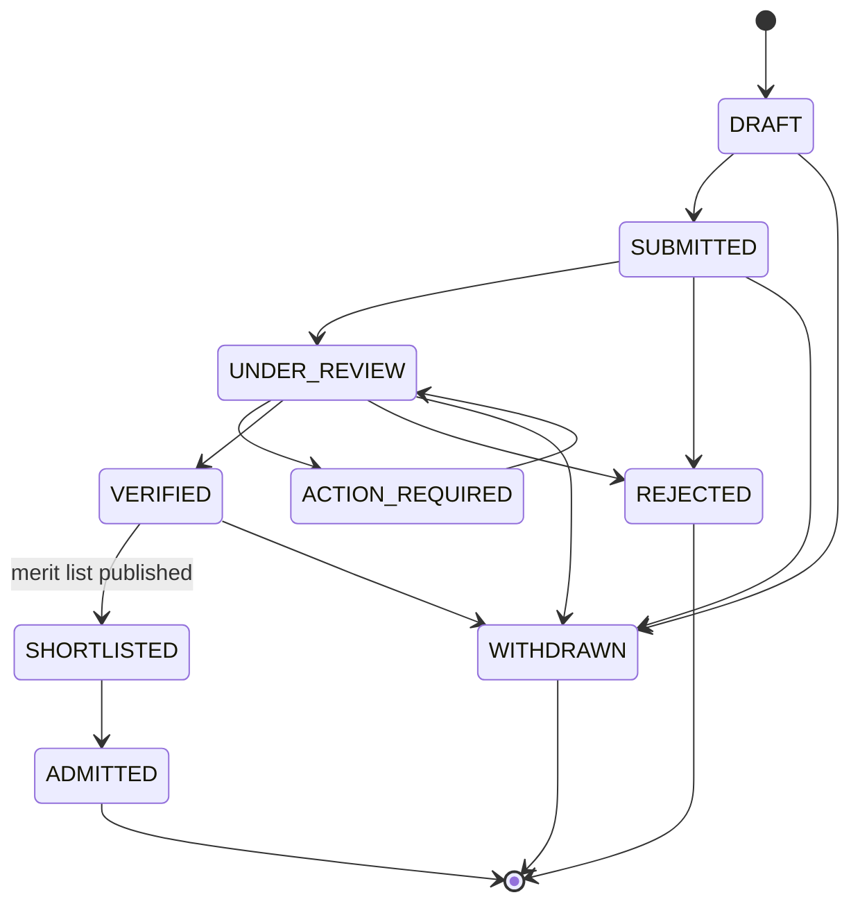

# Online College Admission Management System

A MERN application that digitises the full admission cycle: applicants apply online, upload
documents and pay the fee; verification officers check each document and move applications
through an auditable status pipeline; administrators manage courses, cut-offs, merit lists and
analytics — all from one dashboard.

> **Stack:** MongoDB + Mongoose · Express 4 · React 18 (Vite) · Node 18+ — JavaScript, ES modules,
> on both sides.

---

## 1. Quick start

```bash
npm run install:all          # installs server + client dependencies
npm run db                   # terminal 1 — local MongoDB on :27017 (no Docker needed)
npm run seed                 # terminal 2 — staff, 10 courses, ~40 applications
npm run dev                  # starts db + API (:5050) + client (:5173)
```

Then open **http://localhost:5173**.

| What | Where |
|---|---|
| Client | http://localhost:5173 |
| API | http://localhost:5050/api/v1 |
| Health check | http://localhost:5050/api/v1/health |
| Public results | http://localhost:5173/results |

### Demo accounts

| Role | Email | Password |
|---|---|---|
| Administrator | `admin@college.test` | `Admin@12345` |
| Verification officer | `officer@college.test` | `Officer@12345` |
| Applicant (any seeded one) | `aarav.verma0@example.com` | `Applicant@123` |

The login page has a **Demo accounts** row that fills the form for you.

### Databases you can use

The server picks a database in this order:

1. `MONGO_URI` from `.env` — MongoDB Atlas or any local/remote mongod.
2. `npm run db` — a real `mongod` pinned to `127.0.0.1:27017` with its data in `server/.mongo-data`.
   Binary comes from `mongodb-memory-server`; no Docker or Atlas account required.
3. `docker compose up -d` — mongo + mongo-express (http://localhost:8081) if you prefer containers.
4. Nothing configured at all — the API boots an in-process MongoDB. Handy for a one-off run, but the
   data disappears when the process exits, so the seed script cannot reach it.

> Port 5000 is taken by AirPlay Receiver on macOS, so the API defaults to **5050**.

---

## 2. Architecture



### Data model



### Status pipeline



Every move is validated against `server/src/constants/status.js`; an illegal transition returns
**400** and nothing changes. Each accepted move appends `{ from, to, changedBy, remarks, at }` to
`statusHistory`, which is exactly what the applicant timeline and the staff audit trail render.

---

## 3. Repository layout

```
.
├── client/                      React 18 + Vite + Tailwind
│   └── src/
│       ├── api/                 axios instance (refresh interceptor) + one module per resource
│       ├── components/common/   Button, Input, Table, Modal, StatusBadge, Stepper, Skeleton…
│       ├── components/layout/   Navbar, Sidebar, AppLayout, ProtectedRoute, NotificationBell
│       ├── context/             AuthContext, SocketContext
│       ├── hooks/               useApi, useDebouncedValue
│       ├── pages/auth|applicant|admin
│       └── constants/           status/roles/documents mirrored from the server
├── server/
│   ├── scripts/dev-mongo.js     local mongod for development
│   ├── seed/                    staff, courses, ~40 applications
│   ├── src/
│   │   ├── config/              env, db, cloudinary, razorpay
│   │   ├── constants/           status (+ transition map), roles, documents, categories
│   │   ├── controllers/         auth, course, application, document, payment, review, merit, admin
│   │   ├── middleware/          auth, requireRole, validate, upload, rateLimit, errorHandler
│   │   ├── models/              User, Course, Application, Document, Payment, MeritList, Notification
│   │   ├── services/            merit, storage, mailer, notify, payment, application
│   │   └── sockets/             Socket.IO server + emitters
│   └── tests/                   vitest + supertest
├── docker-compose.yml
└── .env.example
```

---

## 4. Environment variables

Copy `.env.example` to `server/.env` (a repo-root `.env` also works) and fill in what you need.
Everything optional has a working development default.

| Variable | Default | Purpose |
|---|---|---|
| `NODE_ENV` | `development` | Enables dev conveniences (OTP in the API response, verbose logs). |
| `PORT` | `5050` | API port. |
| `CLIENT_ORIGIN` | `http://localhost:5173` | Comma-separated CORS allow-list. |
| `MONGO_URI` | *(empty)* | Mongo connection string. Empty ⇒ in-process MongoDB (dev only). |
| `JWT_ACCESS_SECRET` | `dev-access-secret` | Signs the 15-minute access token. **Change in production.** |
| `JWT_REFRESH_SECRET` | `dev-refresh-secret` | Signs the refresh token stored in an httpOnly cookie. |
| `ACCESS_TOKEN_TTL` / `REFRESH_TOKEN_TTL` | `15m` / `7d` | Token lifetimes. |
| `BCRYPT_ROUNDS` | `12` | Password hashing cost. |
| `SMTP_HOST` / `SMTP_PORT` / `SMTP_USER` / `SMTP_PASS` | *(empty)* | Ethereal or Mailtrap. Empty ⇒ emails are logged, never sent. |
| `MAIL_FROM` | `College Admissions <no-reply@college.test>` | From header. |
| `CLOUDINARY_CLOUD_NAME` / `_API_KEY` / `_API_SECRET` | *(empty)* | Empty ⇒ uploads go to `server/uploads` through the local-disk driver. |
| `UPLOAD_DIR` | `uploads` | Local upload root. |
| `MAX_UPLOAD_BYTES` | `5242880` | 5 MB per file; mime allow-list is pdf/jpeg/png. |
| `RAZORPAY_KEY_ID` / `RAZORPAY_KEY_SECRET` | *(empty)* | **Test keys only.** Empty ⇒ mock gateway (no network call, no charge). |
| `RAZORPAY_WEBHOOK_SECRET` | *(empty)* | HMAC secret for webhook signature verification. |
| `APPLICATION_FEE_PAISE` | `75000` | ₹750.00. |
| `ADMISSION_CYCLE` | `2026-27` | Scopes courses, applications and merit lists. |
| `SEED_ADMIN_EMAIL` / `SEED_ADMIN_PASSWORD` | `admin@college.test` / `Admin@12345` | Seeded administrator. |
| `SEED_OFFICER_EMAIL` / `SEED_OFFICER_PASSWORD` | `officer@college.test` / `Officer@12345` | Seeded officer. |

No secret ever reaches the browser: the client only sees `RAZORPAY_KEY_ID` (public by design) and
only when real keys are configured.

---

## 5. API surface

All routes are prefixed `/api/v1` and answer `{ success, data, message }`; errors add `errors[]`.

| Method | Route | Access |
|---|---|---|
| POST | `/auth/register` → OTP | public |
| POST | `/auth/verify-otp`, `/auth/resend-otp` | public |
| POST | `/auth/login`, `/auth/refresh`, `/auth/logout` | public |
| GET | `/auth/me` | authenticated |
| GET | `/courses`, `/courses/:id` | public |
| POST/PATCH/DELETE | `/courses`, `/courses/:id`, `/courses/:id/cutoff` | admin |
| POST | `/applications` (creates a draft) | applicant |
| GET | `/applications/mine`, `/applications/course-options` | applicant |
| PATCH | `/applications/:id` (draft or action-required only) | owner |
| POST | `/applications/:id/submit`, `/applications/:id/withdraw` | owner |
| GET | `/applications` `?status=&course=&q=&mine=&page=&limit=` | officer, admin |
| GET | `/applications/:id` | owner, officer, admin |
| PATCH | `/applications/:id/status` | officer, admin |
| PATCH | `/applications/:id/assign` | admin |
| GET/POST | `/applications/:id/documents` | owner (+ staff read) |
| DELETE | `/documents/:id` (while PENDING) | owner |
| PATCH | `/documents/:id/verify` | officer, admin |
| GET/POST | `/payments/mine`, `/payments/order`, `/payments/confirm` | applicant |
| POST | `/payments/webhook` | Razorpay (HMAC-verified) |
| GET/POST | `/merit`, `/merit/generate`, `/merit/preview/:id`, `/merit/publish/:id` | admin |
| GET | `/merit/published` | public |
| GET/PATCH | `/notifications`, `/notifications/:id/read`, `/notifications/read-all` | authenticated |
| GET | `/admin/stats`, `/admin/officers` | officer, admin |
| POST/PATCH | `/admin/officers`, `/admin/officers/:id` | admin |

Every list endpoint paginates: `limit` defaults to 20 and is hard-capped at 100.

---

## 6. Merit calculation

`server/src/services/merit.js` is a pure module (no database access), which is why it is directly
unit-tested:

```
meritScore = academicPercentage × 0.80 + requiredSubjectAverage × 0.20
```

1. Only `VERIFIED` applications that list the course as a preference are considered.
2. Anyone below their **category** cut-off (`course.cutOff.{general,obc,sc,st}`) is excluded first.
3. Sort by score ↓, then required-subject average ↓, then earlier `submittedAt`, then earlier DOB.
4. Seats are allotted top-down until `course.totalSeats`; those entries get `allotted: true`.
5. Generating is idempotent — it replaces an unpublished draft and refuses to touch a published list.

Publishing writes `meritScore`/`meritRank` back to each application, moves allotted applicants to
`SHORTLISTED`, updates `course.seatsFilled` and notifies everyone on the list.

---

## 7. Security

- Access tokens live 15 minutes; the refresh token sits in an httpOnly, SameSite=Lax cookie scoped
  to `/api/v1/auth`. Rotation keeps the previous token valid for 30 seconds so parallel refreshes
  (two tabs, React StrictMode) cannot lock a user out.
- Protected routes fail closed: no token or a malformed token ⇒ **401**; wrong role ⇒ **403**.
  Roles always come from the database record, never from the request body.
- `helmet`, a CORS allow-list, and `express-rate-limit` (30 auth attempts / 15 min, 300 API
  requests / min) are on by default.
- Uploads: memory storage → 5 MB limit → `pdf|jpeg|png` allow-list → storage driver.
- Razorpay webhooks are verified with a timing-safe HMAC over the **raw** request body.
- Passwords are bcrypt hashes (12 rounds) and `passwordHash` is `select: false` everywhere.

---

## 8. Tests

```bash
npm test            # 35 tests: merit maths, auth/roles, status transitions
```

The suite boots its own in-process MongoDB, so it never touches your development data.

| File | Covers |
|---|---|
| `tests/merit.test.js` | subject averaging, score weighting, cut-off exclusion, tie-breaks, seat allotment |
| `tests/auth.test.js` | registration, OTP, password hashing, login guards, refresh rotation, 401/403 behaviour |
| `tests/status.test.js` | transition map, illegal transitions, remark requirements, document gate, submit completeness |

---

## 9. Demo walkthrough (≈8 minutes)

1. **Public site** — open `/`, show live course cards (seats, eligibility, cut-offs), then `/results`
   for the published BTCSE merit list.
2. **Register** — `/register` with a new email. The OTP is shown on screen in development; verify it
   and you land on the applicant dashboard.
3. **Apply** — fill the five-step form (Personal → Address → Academics → Preferences → Review). Note
   the live percentage calculation and that each step saves a draft.
4. **Documents** — upload a PDF for 10th/12th marksheet, photo and signature; show the 5 MB /
   mime-type rejection by trying a `.txt`.
5. **Pay** — `/app/payment`, pay ₹750 through the mock gateway (or real Razorpay test checkout if
   keys are set).
6. **Submit** — `/app/status`, the checklist is now empty, submit; the timeline gains a SUBMITTED entry.
7. **Officer** — sign in as `officer@college.test` in another browser profile, open the queue, filter
   by status, open the application, approve documents, move SUBMITTED → UNDER_REVIEW → VERIFIED.
   Try ADMITTED directly to show the 400 from the transition map. Watch the applicant's bell light up
   in real time.
8. **Administrator** — sign in as `admin@college.test`: dashboard counters, cut-off editing, then
   **Merit lists** → generate for a course → preview ranks → publish. Shortlisted applicants are
   notified and seats fill on the dashboard.
9. **Applicant again** — `/app/status` now shows rank, score and the allotment card.

---

## 10. Scripts

| Command | What it does |
|---|---|
| `npm run install:all` | installs both workspaces |
| `npm run db` | local mongod on :27017 (data in `server/.mongo-data`) |
| `npm run dev` | db + API + client together |
| `npm run seed` | staff, courses, ~40 applications (`-- --fresh` wipes applications first) |
| `npm test` | server test suite |
| `npm run lint` | ESLint over both workspaces |
| `npm run build --prefix client` | production client bundle |
